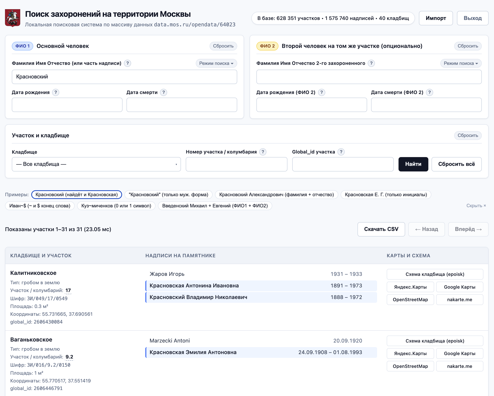

# Захоронения Москвы

Быстрая локальная поисковая система по архивным выгрузкам реестра захоронений Москвы (набор открытых данных **64023** портала Правительства Москвы `data.mos.ru` — *«Поиск захоронений на территории города Москва»*, реестр ГБУ «Ритуал»).

Поисковая логика, синтаксис запросов и структура фильтров программы реализованы на основе проекта **[epoisk.ru/burmsk/](https://epoisk.ru/burmsk/)**.

Программа работает **полностью автономно на вашем компьютере** без подключения к интернету и без передачи поисковых запросов на внешние серверы. База данных индексируется локально, а интерфейс открывается как привычная страница в вашем браузере.



---

## Ключевые возможности

- **Мгновенный поиск** по сотням тысяч участков и миллионам надписей на памятниках даже на слабых компьютерах.
- **Полноценный генеалогический синтаксис запросов (совместимый с [epoisk.ru/burmsk/](https://epoisk.ru/burmsk/))**:
  - автоматический учёт мужских и женских окончаний фамилий (`Красновский` найдёт и `Красновский`, и `Красновская`);
  - точная форма слова в кавычках (`"Красновский"`), точные инициалы с точками (`Е. Я.`), фиксация конца слова (`$`), шаблоны с `?` (1 символ), `~` (0 или 1 символ), `*` (любое число символов) и `|` (логическое ИЛИ);
  - поиск по имени и отчеству без фамилии, а также поиск совпадений в середине слов.
- **Гибкая фильтрация по датам жизни**: поиск по году (`1954`), месяцу и году (`03.1954`), полной дате (`16.03.1954`), закрытым и открытым диапазонам (`1900-1967`, `1900-12.12.1967`, `1900-`, `-1967`) с автоматическим учётом памятников, где выбит только год.
- **Поиск родственных (совместных) захоронений (`ФИО 1 + ФИО 2`)**: отбор участков, на которых одновременно захоронены два указанных человека.
- **Умное слияние нескольких выгрузок**: при последовательном импорте разных архивных срезов более свежие записи обновляют устаревшие, а недостающие поля (шифры участков, координаты и площадь ограды) автоматически дополняют друг друга.
- **Карты и экспорт**: прямые ссылки с каждого найденного участка на схему кладбища `epoisk.ru`, Яндекс.Карты, Google Maps, OpenStreetMap и спутниковые снимки `nakarte.me`, копирование карточки в буфер обмена и выгрузка выборки в `CSV` (Excel).

---

## 1. Скачивание и первый запуск (Windows и macOS)

Готовые автономные сборки для Windows и macOS не требуют установки Python или дополнительных библиотек — архив для вашей операционной системы доступен в разделе [Releases](https://github.com/old-worm/moscow-burials/releases).

> **Примечание о безопасности:** если вы не хотите запускать готовые исполняемые файлы (`.exe` / `.app`), вы можете [скачать исходный код репозитория](https://github.com/old-worm/moscow-burials), самостоятельно проверить его (в проекте нет ни одной сторонней библиотеки — используется только стандартная библиотека Python) и запустить программу напрямую через терминал (см. [раздел 5](#5-запуск-на-linux-работа-из-исходного-кода-и-терминальный-cli)).

> **Важно:** сама база захоронений в дистрибутив программы не входит. При первом запуске программа откроет панель импорта, где вам нужно будет выбрать ваш файл архивной выгрузки набора `64023`.

### Windows (`Windows 7 SP1 / 8.1 / 10 / 11`, 64-бит)

1. Скачайте архив **`moscow-burials-<версия>-windows-x64.zip`** на странице [Releases](https://github.com/old-worm/moscow-burials/releases) и **полностью распакуйте** папку `Захоронения Москвы` в любое удобное место (например, на рабочий стол или диск `D:\`).
2. Запустите файл **`Захоронения Москвы.exe`**.
3. **Если появилось синее окно фильтра Windows Defender SmartScreen** (*«Система Windows защитила ваш компьютер»*):
   - Это стандартное предупреждение Windows для бесплатных программ с открытым кодом, не подписанных коммерческим сертификатом Microsoft.
   - Нажмите **«Подробнее»** (*More info*), а затем кнопку **«Выполнить в любом случае»** (*Run anyway*) — либо запустите программу напрямую из исходного кода на Python ([раздел 5](#5-запуск-на-linux-работа-из-исходного-кода-и-терминальный-cli)).
4. В вашем браузере автоматически откроется адрес `http://127.0.0.1:64023/`.

### macOS (`macOS 10.15 Catalina` и новее на Intel, `macOS 11 Big Sur` и новее на Apple Silicon)

1. Скачайте образ диска **`moscow-burials-<версия>-macos-universal.dmg`** на странице [Releases](https://github.com/old-worm/moscow-burials/releases) и откройте его двойным кликом. В открывшемся окне перетащите значок **«Захоронения Москвы»** на папку **«Программы»** — по стрелке. После копирования образ можно извлечь (кнопка ⏏ рядом с ним в боковой панели Finder).
2. **При первом запуске на macOS (защита Gatekeeper)**:
   - Поскольку приложение распространяется бесплатно и подписано локальной (`ad-hoc`) подписью без платного сертификата Apple Developer, при обычном двойном клике macOS покажет предупреждение *«Приложение не открыто, так как Apple не может проверить его на наличие вредоносного ПО»*.
   - **Способ 1 (любая версия macOS)**: закройте предупреждение, откройте **Системные настройки → Конфиденциальность и безопасность** (в macOS 12 и раньше — **Защита и безопасность → Основные**), прокрутите вниз до блока «Безопасность» и нажмите **«Открыть в любом случае»** напротив `Захоронения Москвы.app`, затем подтвердите паролем. Кнопка появляется после попытки запуска и доступна около часа.
   - **Способ 2 (только macOS 10.15–14)**: нажмите на иконку `Захоронения Москвы.app` **правой кнопкой мыши** (или удерживая `Ctrl`) → выберите **«Открыть»** → в появившемся окне подтвердите **«Открыть»**. Начиная с macOS 15 Sequoia этот приём больше не работает — используйте способ 1.
   - **Способ 3 (через Терминал)**: выполните команду снятия карантинного атрибута:
     ```bash
     xattr -cr "/Applications/Захоронения Москвы.app"
     ```
   - Либо вы можете не использовать `.app`-сборку и запустить программу напрямую из исходного кода через `./run.sh` ([раздел 5](#5-запуск-на-linux-работа-из-исходного-кода-и-терминальный-cli)).
3. После запуска приложение автоматически откроет вкладку `http://127.0.0.1:64023/` в браузере.

---

## 2. Где взять данные и как загрузить их в базу

В настоящее время набор открытых данных **64023** (*«Поиск захоронений на территории города Москва»*) удалён с официального портала `data.mos.ru`, поэтому для работы программы используются ранее сохранённые архивные выгрузки этого набора.

### Статус поддержки форматов выгрузок

- **Таблицы Excel (`.xlsx`)** — **полностью протестированы и гарантированно поддерживаются** (оригинальные выгрузки `data.mos.ru`, сформированные `Apache POI`, как стандартные, так и содержащие колонку геокоординат `geoData`).
- **Форматы `.csv`, `.json` и `.xml`** — базовая поддержка этих форматов заложена в программу по общей спецификации портала `data.mos.ru`, однако на реальных архивных файлах набора `64023` они ещё не проверялись из-за отсутствия образцов.
  > Если у вас сохранился оригинальный архивный дамп набора `64023` в формате `.csv`, `.json` или `.xml` (или при его загрузке возникла ошибка) — пожалуйста, создайте обращение в разделе [Issues](https://github.com/old-worm/moscow-burials/issues) и поделитесь образцом структуры файла, чтобы мы могли доработать и протестировать парсер.

### Как импортировать файлы в программу

1. **Если ваша выгрузка упакована в архив (`.zip`, `.rar`, `.7z`, `.gz`)** — предварительно **распакуйте архив**, чтобы получить сам файл данных (например, `.xlsx`). Если попытаться загрузить нераспакованный архив, старый формат Excel 97–2003 (`.xls`) или повреждённый файл, программа сразу предупредит об этом и подскажет, что нужно сделать.
2. В открывшемся окне программы («Импорт и обновление базы из файлов-источников»):
   - **Либо перетащите файл мышью** в область загрузки (или нажмите **«Выберите файл | Перетащите»** → **«Загрузить и импортировать»**);
   - **Либо нажмите кнопку «Открыть папку input/»**, скопируйте туда один или несколько файлов выгрузок через Проводник / Finder, после чего нажмите **«Импортировать»** напротив нужного файла в таблице.
3. Дождитесь завершения потокового импорта и построения поисковых индексов, затем нажмите кнопку **«К поиску →»**.

   > **Импорт может занять заметное время.** Выгрузка содержит миллионы записей, поэтому на слабых или старых компьютерах импорт может длиться **десятки минут**. Это нормально: не закрывайте окно программы и не прерывайте процесс, пока импорт не завершится — ход выполнения отображается на панели импорта.

### Слияние нескольких файлов («Свежесть + Полнота»)

Вы можете последовательно импортировать в одну базу несколько разных архивных выгрузок (например, разных дат или разной полноты):
- Дата актуальности выгрузки автоматически извлекается из внутренних метаданных `.xlsx` (`docProps/core.xml`) или из имени файла (заглушка `2999-01-01` автоматически игнорируется). При желании дату среза можно указать вручную перед импортом.
- Более свежий файл обновляет надписи на участках, но **сохраняет** уже имеющиеся в базе шифры мест (`PlaceNumber`) или геокоординаты, если в новом файле они отсутствуют.
- Более старый архивный файл **не затирает** свежие надписи, а только дозаполняет пустые поля.
- При загрузке файлов через браузер программа проверяет контрольную сумму `SHA-256` и не создаёт дубликатов в папке `input/`.

---

## 3. Руководство по поиску

### 3.1. Поиск по ФИО и окончаниям слов

В поле **«Фамилия Имя Отчество»** достаточно ввести полное ФИО или известную часть в любом регистре (буквы `е` и `ё` считаются эквивалентными):

- **Родовые окончания фамилий учитываются автоматически**: по запросу `Красновский` программа найдёт как мужскую форму (`Красновский`), так и женскую (`Красновская`); аналогично для фамилий на `-ов/-ова`, `-ев/-ева`, `-ин/-ина`.
- **Два слова в запросе**: если ввести `Красновский Евгений` или `Красновский Яковлевич`, второе слово автоматически проверяется одновременно и как имя, и как отчество (на случай, если на памятнике выбиты только фамилия и отчество).
- **Поиск по началам слов**: запрос `Красновс Евген Яковлев` найдёт полные формы `Красновский Евгений Яковлевич`.

### 3.2. Таблица специальных операторов

| Оператор | Назначение | Пример запроса | Что найдёт / как работает |
| :---: | :--- | :--- | :--- |
| **`"..."`** | Точная форма слова (отключает автоподстановку окончаний) | `"Красновский"` | Найдёт только мужскую форму `Красновский` (исключая `Красновская`). |
| **`.`** | Точный однобуквенный инициал на памятнике | `Красновский Е. Я.` | Найдёт только записи, где на памятнике выбиты сокращённые инициалы (`Красновский Е. Я.`), и **не** включит полное `Красновский Евгений Яковлевич`. Без точек (`Красновский Е Я`) найдёт и инициалы, и полные имена. |
| **`$`** | Фиксация конца слова | `Иван$` | Найдёт имя `Иван`, но исключит `Ивана`, `Иванов` и `Иванович`. |
| **`~`** | `0` или `1` любой символ в указанной позиции | `Куз~миченков`<br>`Иван~$` | Найдёт оба варианта написания (`Кузмиченков` и `Кузьмиченков`).<br>`Иван~$` найдёт `Иван` и `Ивана`, но не `Иванов`. |
| **`?`** | Ровно `1` любой символ в указанной позиции | `Натал?я` | Найдёт и `Наталья`, и `Наталия`. |
| **`*`** | Любая последовательность символов (`0` или более) | `Соколов-Микитов*` | Найдёт все слова с указанным префиксом/шаблоном. |
| **`\|`** | Логическое ИЛИ внутри одного слова | `Елена\|Алена` | Найдёт записи с любым из перечисленных вариантов имени или фамилии. |

### 3.3. Режимы поиска (кнопка «Режим поиска ▾»)

1. **Начала всех слов должны совпадать (по умолчанию: Ф → И → О)** — 1-е слово ищется в фамилии, 2-е в имени (или отчестве), 3-е в отчестве. Самый быстрый и точный режим.
2. **Фамилия в запросе не указана** — позволяет искать человека только по имени и отчеству (например, `Евгений Яковлевич`) или по произвольному тексту надписи на памятнике в любом порядке слов.
3. **Дополнительно включать совпадения в середине слов (триграммы)** — находит подстроки внутри слов (полезно при сильных искажениях или опечатках в начале фамилии).

### 3.4. Даты рождения и смерти

В полях **«Дата рождения»** и **«Дата смерти»** поддерживаются как точные значения, так и интервалы через дефис:

- **Точный год**: `1954`
- **Месяц и год**: `03.1954`
- **Полная дата**: `16.03.1954`
- **Закрытый диапазон**: `1900-1967`, `02.1967-10.1967`, `1900-12.12.1967`, `01.05.1900-12.12.1967`
- **Открытый диапазон**: `1900-` (начиная с 1900 г. и позже), `-1967` (до 1967 г. включительно)

> **Особенность учёта неполных дат:** на многих памятниках выбит только год рождения и год смерти (без дня и месяца). Если вы задаёте диапазон с точностью до дня или месяца (например, `15.12.1970-10.08.2016`), программа автоматически включает в выдачу памятники, где указан просто `1970` или `2016` год, чтобы вы не потеряли нужного человека.

### 3.5. Поиск совместных (родственных) захоронений (`ФИО 1 + ФИО 2`)

Если вы знаете двух родственников, похороненных в одной ограде или колумбарной нише, заполните блок **«ФИО 1»** для первого человека и блок **«ФИО 2»** для второго (можно указать только имя, фамилию или годы жизни). Программа мгновенно отберёт только те участки, где числятся оба человека одновременно, и подсветит первого синим маркером, а второго — жёлтым.

### 3.6. Карты, схема кладбища и выгрузка в CSV

В результатах поиска для каждого участка доступны:
- **«Схема участка (epoisk)»** — интерактивная карта-схема кладбища на `epoisk.ru` с подсветкой найденного участка по его `global_id`.
- **«Яндекс.Карты»**, а также в меню **«Ещё ▾»**: **Google Maps**, **OpenStreetMap** и **nakarte.me (спутник Bing)** — при наличии геокоординат участка в базе.
- **Кнопка копирования** рядом с каждой персоной и кнопка копирования всей карточки участка целиком.
- **«Скачать CSV»** — выгрузка найденных участков в таблицу CSV (`UTF-8 с BOM`, разделитель `;`), которая сразу корректно открывается в Microsoft Excel.

---

## 4. Устройство, хранение данных и решение проблем

### Где программа хранит базу данных и файлы

Программа создаёт четыре рабочие папки:
- `input/` — папка с вашими исходными файлами выгрузок (`.xlsx`, `.csv`, `.json`, `.xml`);
- `output/burials.db` — проиндексированная база данных SQLite (в версии 0.1.0 файл назывался `graves.db`; при запуске новой версии он переименовывается автоматически);
- `logs/` — журнал работы `app.log` и диагностический архив `moscow-burials-diagnostic.zip`;
- `tmp/` — временные файлы при загрузке.

Расположение этих папок зависит от операционной системы:
- **Windows (Portable)**: все папки (`input/`, `output/`, `logs/`, `tmp/`) создаются **прямо внутри папки с программой рядом с `Захоронения Москвы.exe`**. Вы можете переносить всю папку с программой и готовой базой на флешке. *(Если программа помещена в защищённую системную директорию без прав записи, например `C:\Program Files`, данные автоматически сохраняются в `%LOCALAPPDATA%\moscow-burials`).*
- **macOS (`Захоронения Москвы.app`)**: по стандартам macOS рабочие данные приложения хранятся в папке поддержки приложений в библиотеке пользователя:
  ```text
  ~/Library/Application Support/moscow-burials/
  ```
  Чтобы быстро перейти в папку `input/` из интерфейса программы, просто нажмите кнопку **«Открыть папку input/»** на панели импорта — откроется окно Finder / Проводника.
- **При запуске из исходного кода (`./run.sh` или `python -m scripts.web`)**: папки создаются непосредственно в корне репозитория.

### Как завершать работу программы

- **Кнопка «Выход»** в правом верхнем углу веб-интерфейса мгновенно и корректно останавливает локальный сервер.
- **Автоматическое выключение**: если вы просто закрыли все вкладки браузера с программой, локальный фоновый процесс подождёт **10 минут** (на случай, если вы захотите вернуться или случайно закрыли вкладку) и автоматически завершит работу, не занимая ресурсы компьютера. Во время выполнения импорта автовыключение блокируется до окончания загрузки.
- **Повторный клик по ярлыку программы**: если сервер уже запущен в фоне, повторный запуск `Захоронения Москвы` не создаёт второй процесс, а просто открывает новую вкладку поиска в браузере.

### Диагностика и журнал работы (`logs/`)

Если при импорте файла или работе программы возникла ошибка и вы хотите обратиться за помощью в [Issues](https://github.com/old-worm/moscow-burials/issues):
1. На панели импорта (а также в нижней части страницы поиска или прямо в окне ошибки) нажмите кнопку **«Скачать лог (.zip)»** или **«Показать лог в папке»**.
2. Программа сформирует архив `moscow-burials-diagnostic.zip`, содержащий технический журнал `app.log` и сводку о версии ОС и состоянии базы (`diagnostic_info.json`), без включения ваших персональных файлов. Приложите этот `.zip`-архив к вашему сообщению.

---

## 5. Запуск на Linux, работа из исходного кода и терминальный CLI

Ядро программы написано на чистом Python `3.8+` и **не требует установки ни одной внешней библиотеки** (`0` внешних зависимостей — используется только стандартная библиотека Python и встроенный `SQLite` с `FTS5`). Вы можете скачать исходный код репозитория, проверить его и запускать программу напрямую через интерпретатор Python без использования скомпилированных исполняемых файлов.

### Запуск веб-интерфейса из исходников (Linux / macOS / Windows)

Склонируйте репозиторий (или скачайте и распакуйте ZIP-архив с исходным кодом на странице [github.com/old-worm/moscow-burials](https://github.com/old-worm/moscow-burials)):

```bash
git clone https://github.com/old-worm/moscow-burials.git
cd moscow-burials
```

На **Linux** и **macOS** запустите скрипт в корне проекта:
```bash
./run.sh
```
Или запустите веб-интерфейс напрямую через Python `3.8+` на любой ОС (включая Windows):
```bash
python3 -m scripts.web
```
Полезные флаги `scripts.web`:
- `--port 64023` — порт локального сервера (по умолчанию `64023`; если занят другой программой, автоматически выбирается свободный порт);
- `--db path/to/burials.db` — явный путь к файлу базы данных;
- `--no-browser` — не открывать браузер автоматически при старте;
- `--diag` — собрать диагностический архив `logs/moscow-burials-diagnostic.zip` из командной строки.

### Терминальный интерфейс (`scripts/cli.py`)

Для пакетного импорта и быстрого поиска прямо в терминале (включая выдачу в `JSON` для скриптов):

```bash
# Импорт одного или нескольких файлов выгрузок в базу
python3 -m scripts.cli import input/data-64023.xlsx

# Поиск по ФИО с выводом в терминал
python3 -m scripts.cli search "Красновский Евгений"

# Поиск по двум людям на участке, датам и кладбищу
python3 -m scripts.cli search --fio "Введенский Михаил" --fio2 "Введенский Евгений" --cemetery "Алексеевское"

# Вывод результатов поиска в формате JSON
python3 -m scripts.cli search "Щукина Людмила" --birth-exact "1954" --json

# Очистка базы данных (исходные файлы в input/ сохраняются)
python3 -m scripts.cli clear
```

### Самостоятельная сборка автономных дистрибутивов (`scripts/build.py`)

Сборку выполняет PyInstaller. Он собирает приложение только для той системы, в которой запущен: `.app` — на macOS, `.exe` — на Windows (или под Wine на macOS / Linux, см. ниже). Версии инструментов сборки закреплены в `pyproject.toml` (группа `build`). Самой программе сторонние библиотеки не нужны.

```bash
python3 -m venv .venv
.venv/bin/pip install "pyinstaller==6.22.3"   # для Python 3.10+; для Python 3.8 — 6.11.1
.venv/bin/python -m scripts.build
```

На Windows те же команды пишутся через `.venv\Scripts\` (например, `.venv\Scripts\python -m scripts.build`).

Флаги `scripts.build`:

- `--zip` — упаковать приложение в `dist/moscow-burials-<версия>-<macos|windows|linux>-<архитектура>.zip` (`windows-x64`, `linux-x86_64`, `macos-universal`) — для Windows-релиза;
- `--dmg` — только macOS: оформленный образ диска (нужен `dmgbuild==1.6.7`); отдельный `.app` после упаковки в `dist/` не остаётся;
- `--target-arch x86_64|arm64|universal2` — только macOS: архитектура `.app`;
- `--include-db` (и `--db <путь>`) — положить готовую базу внутрь дистрибутива;
- `--name` — другое имя выходного приложения.

#### macOS

> **macOS:** собирайте не Python из Homebrew: он собран только под текущую версию macOS и процессор сборочной машины, и `.app` не запустится на более старых системах или на Intel. Используйте переносимый Python из [python-build-standalone](https://github.com/astral-sh/python-build-standalone/releases) (`cpython-3.14.*-x86_64-apple-darwin-install_only.tar.gz`, распаковать в `.python/` и создать `.venv` командой `.python/python/bin/python3.14 -m venv .venv`) или установщик `universal2` с python.org. Архитектура задаётся флагом `--target-arch` (`x86_64` по умолчанию, `arm64`, `universal2`).
>
> **Сборка `universal2` (Intel + Apple Silicon в одном `.app`)** требует интерпретатора с обеими архитектурами. У python-build-standalone готового universal2 нет, поэтому склейте его из двух сборок одной версии (`cpython-3.14.<N>+<дата>-x86_64-apple-darwin-install_only.tar.gz` и `...-aarch64-apple-darwin-install_only.tar.gz`, каждую распаковать в свою папку):
>
> ```bash
> python3 -m scripts.make_universal_python <папка_x86_64>/python <папка_arm64>/python .python/universal2/python
> .python/universal2/python/bin/python3.14 -m venv .venv-universal2
> .venv-universal2/bin/pip install "pyinstaller==6.22.3" "dmgbuild==1.6.7"
> .venv-universal2/bin/python -m scripts.build --target-arch universal2 --dmg
> ```
>
> Минимальная версия macOS остаётся 10.15 для Intel и 11.0 для Apple Silicon (на Mac с Apple Silicon более старых систем не бывает). Поддержка 10.13 невозможна: у Python 3.14 минимум 10.15.
>
> После сборки скрипт проверяет архитектуру и минимальную версию macOS у каждого бинарника в бандле и завершается с ошибкой, если они не соответствуют `LSMinimumSystemVersion`.

#### Windows

Windows-версия собирается **Python 3.8 (64-бит)** и `pyinstaller==6.11.1`: Python 3.8 — последняя версия, работающая на Windows 7, а сборка на более новом Python на Windows 7 не запустится. Иконка `.exe` берётся из `assets/AppIcon.ico`.

На Windows (установщик Python 3.8.10 x64 с python.org):

```bat
py -3.8 -m venv .venv
.venv\Scripts\pip install "pyinstaller==6.11.1"
.venv\Scripts\python -m scripts.build --zip
```

На macOS или Linux — через [Wine](https://www.winehq.org/), с Windows-Python из официального NuGet-пакета `python` 3.8.10: это обычная папка с `python.exe` и уже установленным `pip`, установщик запускать не нужно. Первый запуск Wine создаёт его рабочую папку (префикс) — это может занять около минуты.

```bash
mkdir -p .python/win
curl -L -o .python/win/python.nupkg https://www.nuget.org/api/v2/package/python/3.8.10
unzip -q .python/win/python.nupkg 'tools/*' -d .python/win
export WINEDEBUG=-all
wine .python/win/tools/python.exe -m pip install "pyinstaller==6.11.1"
wine .python/win/tools/python.exe -m scripts.build --zip
```

Результат — папка `dist/Захоронения Москвы/` (`Захоронения Москвы.exe` и `_internal/`) и архив `dist/moscow-burials-<версия>-windows-x64.zip`.

#### Результат сборки

Готовая сборка появится в папке `dist/`. На macOS для Releases используйте флаг `--dmg` (нужен пакет `dmgbuild`): рядом будет создан оформленный образ диска `dist/moscow-burials-<версия>-macos-<universal|x86_64|arm64>.dmg` — версия берётся из `src/__init__.py` (`__version__`). В окне образа — фон со стрелкой (макет `assets/dmg-background.svg`, рендерится в 1x и @2x для Retina), приложение и ярлык «Программы»; иконка тома — иконка приложения; HFS+, сжатие ULMO (macOS 10.15+). После упаковки скрипт проверяет образ (`hdiutil verify`) и подпись приложения внутри него, а сам `.app` из `dist/` удаляет — он уже есть в образе. С флагом `--zip` рядом будет создан архив `dist/moscow-burials-<версия>-<macos|windows|linux>-<архитектура>.zip` (`windows-x64`, `linux-x86_64`, `macos-universal`), содержащий только само приложение без служебных файлов ОС (`.DS_Store`, `Thumbs.db` и т. п.) — для Windows публикуется он. Подробная архитектура базы данных, грамматика шифров `PlaceNumber` и надписей `Inscription` описаны в технической спецификации [`SPEC.md`](SPEC.md).

---

## Обратная связь

Вопросы, сообщения об ошибках и образцы архивных выгрузок набора `64023` в форматах `.csv`, `.json` и `.xml` присылайте в раздел [GitHub Issues](https://github.com/old-worm/moscow-burials/issues).
